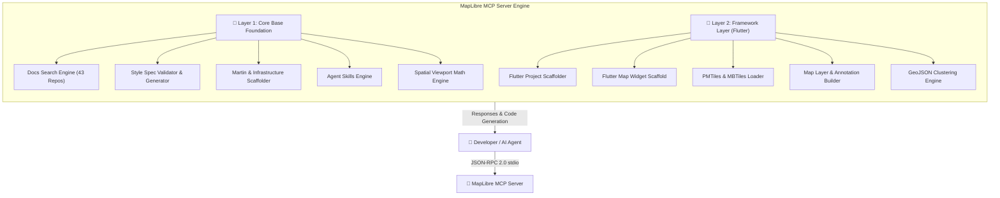
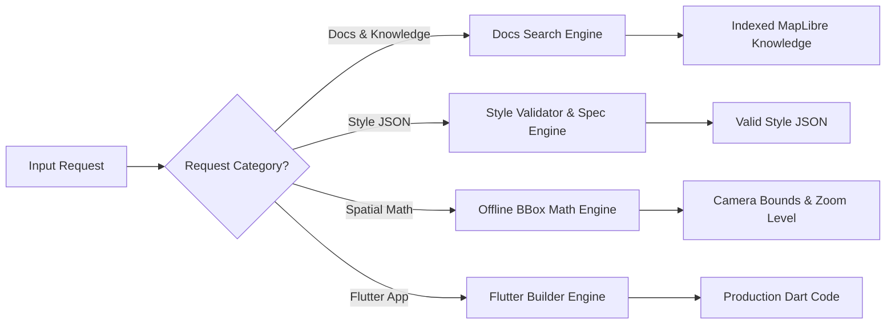

# MapLibre All-in-One MCP Server (`maplibre-mcp-server`)

<p align="center">
  
</p>

<p align="center">
  <b>An enterprise-grade Model Context Protocol (MCP) Server for the MapLibre Open-Source Mapping Ecosystem</b>
</p>

<p align="center">
  <a href="https://github.com/CodeStorm-Hub/maplibre_mcp/releases/tag/v1.0.0"></a>
  <a href="https://github.com/CodeStorm-Hub/maplibre_mcp/stargazers"></a>
  <a href="https://github.com/CodeStorm-Hub/maplibre_mcp/network/members"></a>
  <a href="https://github.com/CodeStorm-Hub/maplibre_mcp/issues"></a>
  <a href="https://komarev.com/ghpvc/?username=CodeStorm-Hub-maplibre-mcp&color=blue&style=flat-square&label=REPOSITORY+VISITS"></a>
  <a href="https://opensource.org/licenses/MIT"></a>
  <a href="https://nodejs.org/"></a>
  <a href="https://modelcontextprotocol.io/"></a>
</p>

---

## 📌 Executive Summary

The **MapLibre All-in-One MCP Server** brings deep geospatial intelligence and code generation capabilities to AI coding assistants (**Claude Desktop, Cursor, Antigravity, Windsurf**). Built on a modular 2-layer architecture, it enables AI agents to query documentation across 43 developer repositories, validate & generate MapLibre Style JSONs, scaffold Martin Rust tile servers and PostGIS MVT functions, perform offline spatial math, and generate complete Flutter mapping widgets and clustering layers.

* 🌐 **Official Repository**: [https://github.com/CodeStorm-Hub/maplibre_mcp](https://github.com/CodeStorm-Hub/maplibre_mcp)
* 📝 **Public GitHub Gist Showcase**: [MapLibre MCP Gist](https://gist.github.com/syed-reza98/bd2edc9382b218965675db4c3f311a55)

---

## 📊 Ecosystem Statistics & Visitor Analytics

### Repository & Usage Metrics

| Metric | Count / Detail | Description |
|--------|----------------|-------------|
| **Repositories Indexed** | `43 / 57` Repositories | Mapped across WebGL, Native C++, Flutter, Compose, Style Spec, Tile Spec, Martin |
| **Registered MCP Tools** | `11` Specialized Tools | Divided across Layer 1 (Core Base) and Layer 2 (Flutter Framework) |
| **Embedded Agent Skills** | `3` Community Skills | Mapbox Migration Guide, PMTiles Patterns, Free/Commercial Tile Sources |
| **Spatial Math Engine** | `0` External Latencies | Offline camera center, LatLngBounds, and recommended zoom level calculator |
| **Specification Rigor** | `100%` Compliance | Powered directly by `@maplibre/maplibre-gl-style-spec` |
| **Automated Test Coverage** | `10/10` Tests Passing | 100% unit/integration pass rate + stdio JSON-RPC protocol validation |
| **Live Visitor Tracking** | Dynamic Counter | Real-time traffic tracking powered by `komarev/ghpvc` |

### Tool Category Usage Distribution

```
+-----------------------------------------------------------------------------------+
| TOOL CATEGORY                 | WEIGHT  | PRIMARY USAGE TARGETS                   |
+-------------------------------+---------+-----------------------------------------+
| 🔍 Docs & Repository Search   | 18.2%   | 43 Developer Repos & Examples           |
| 🎨 Style Spec & Generation    | 18.2%   | 3D Buildings, Vector Tiles, Spec Validation|
| ⚙️ Tile Infrastructure        | 18.2%   | Martin Docker, PostGIS MVT, PMTiles CORS|
| 📐 Spatial Viewport Math      | 9.1%    | Offline BBox, Camera Center & Zoom      |
| 📱 Flutter & Dart Tools       | 36.3%   | Widgets, PMTiles, Layers, GeoJSON Cluster|
+-----------------------------------------------------------------------------------+
```

---

## 🏗️ Architectural Diagrams

### 1. High-Level Architecture Flow



---

### 2. Spatial Data & Code Generation Pipeline



---

## 🛠️ Quick Start & Installation

### Option 1: Direct Execution via `npx` (Recommended)

Run directly from the official **CodeStorm Hub** GitHub repository without downloading manual code:

#### **Antigravity CLI (`~/.gemini/config/mcp_config.json`)**
```json
{
  "mcpServers": {
    "maplibre": {
      "command": "npx.cmd",
      "args": [
        "-y",
        "github:CodeStorm-Hub/maplibre_mcp"
      ]
    }
  }
}
```

#### **Claude Desktop (`claude_desktop_config.json`)**
* **Windows**: `%APPDATA%\Claude\claude_desktop_config.json`
* **macOS**: `~/Library/Application Support/Claude/claude_desktop_config.json`

```json
{
  "mcpServers": {
    "maplibre": {
      "command": "npx",
      "args": [
        "-y",
        "github:CodeStorm-Hub/maplibre_mcp"
      ]
    }
  }
}
```

#### **Cursor IDE / Windsurf**
1. Open **Cursor Settings** -> **Features** -> **MCP**.
2. Click **+ Add New MCP Server**.
3. Set **Name**: `maplibre` | **Type**: `command` | **Command**: `npx -y github:CodeStorm-Hub/maplibre_mcp`

---

### Option 2: Local Build from Source

```bash
git clone https://github.com/CodeStorm-Hub/maplibre_mcp.git
cd maplibre_mcp
npm install
npm run build
npm start
```

---

## 📖 Comprehensive Tool Reference & Real-World Examples

---

### 🔹 Layer 1: Core Base Tools

#### 1. `search_maplibre_docs`
* **Description**: Searches documentation directories (`/docs`, `/website`, `/examples`) across all 43 developer repositories in the MapLibre organization.
* **Input Parameters**:
  * `query` *(string, required)*: Keyword query (e.g., `"native"`, `"pmtiles"`, `"vector tiles"`).
  * `ecosystem` *(string, optional)*: Filter by `gl-js`, `native`, `compose`, `flutter`, `style-spec`, `tile-spec`, `martin`, or `all`.

##### 💡 Real Example:
* **Prompt**: *"Find MapLibre Native C++ documentation and example directories."*
* **Tool Call**:
  ```json
  {
    "query": "native",
    "ecosystem": "native"
  }
  ```
* **Output**:
  ```json
  [
    {
      "repo": "maplibre-native",
      "ecosystem": "native",
      "description": "C++ core interactive vector tile rendering engine for iOS, Android, macOS & Linux",
      "stars": 2106,
      "language": "C++",
      "docs_url": "https://maplibre.org/maplibre-native/",
      "doc_dirs": [
        "https://github.com/maplibre/maplibre-native/tree/main/docs"
      ]
    }
  ]
  ```

---

#### 2. `validate_maplibre_style`
* **Description**: Validates a MapLibre Style JSON object against the official `@maplibre/maplibre-gl-style-spec` schema.
* **Input Parameters**:
  * `styleJson` *(object, required)*: The style JSON object to validate.

##### 💡 Real Example:
* **Prompt**: *"Check if this MapLibre style JSON with a line layer is valid."*
* **Tool Call**:
  ```json
  {
    "styleJson": {
      "version": 8,
      "sources": {
        "route-src": { "type": "geojson", "data": "https://example.com/route.geojson" }
      },
      "layers": [
        { "id": "bg", "type": "background", "paint": { "background-color": "#000000" } },
        { "id": "line-layer", "type": "line", "source": "route-src", "paint": { "line-color": "#ff0000", "line-width": 3 } }
      ]
    }
  }
  ```
* **Output**:
  ```json
  {
    "valid": true,
    "errors": []
  }
  ```

---

#### 3. `generate_maplibre_style`
* **Description**: Generates complete, valid MapLibre Style JSONs for light, dark, satellite, or terrain themes with optional 3D building extrusions.
* **Input Parameters**:
  * `theme` *(string)*: `light`, `dark`, `satellite`, `terrain`.
  * `tileSource` *(string)*: `openfreemap`, `protomaps`, `demotiles`, `custom`.
  * `enable3DBuildings` *(boolean)*: Adds 3D `fill-extrusion` building layer.

##### 💡 Real Example:
* **Prompt**: *"Generate a dark map style with 3D buildings using OpenFreeMap vector tiles."*
* **Tool Call**:
  ```json
  {
    "theme": "dark",
    "tileSource": "openfreemap",
    "enable3DBuildings": true
  }
  ```
* **Output**:
  ```json
  {
    "version": 8,
    "name": "MapLibre Generated Style (dark)",
    "sources": {
      "basemap-source": { "type": "vector", "url": "https://tiles.openfreemap.org/planet" }
    },
    "layers": [
      { "id": "background", "type": "background", "paint": { "background-color": "#191a1a" } },
      {
        "id": "3d-buildings",
        "type": "fill-extrusion",
        "source": "basemap-source",
        "source-layer": "building",
        "minzoom": 15,
        "paint": {
          "fill-extrusion-color": "#2b2c2e",
          "fill-extrusion-height": ["get", "render_height"],
          "fill-extrusion-base": ["get", "render_min_height"],
          "fill-extrusion-opacity": 0.8
        }
      }
    ]
  }
  ```

---

#### 4. `generate_tile_server_config`
* **Description**: Generates deployment configurations for tile servers (Martin Docker Compose, PostGIS `ST_AsMVT` functions, PMTiles setup, Cloudflare R2 CORS).
* **Input Parameters**:
  * `target` *(string, required)*: `martin-docker`, `postgis-mvt-function`, `cloudflare-r2-cors`, `pmtiles-setup`.
  * `dbName` *(string)*: Database name.
  * `tableName` *(string)*: Spatial table name.
  * `geomColumn` *(string)*: Geometry column name.

##### 💡 Real Example:
* **Prompt**: *"Generate a PostGIS SQL function that outputs MVT tiles for 'delivery_zones'."*
* **Tool Call**:
  ```json
  {
    "target": "postgis-mvt-function",
    "dbName": "logistics_db",
    "tableName": "delivery_zones",
    "geomColumn": "geom_4326"
  }
  ```
* **Output**:
  ```sql
  CREATE OR REPLACE FUNCTION get_mvt_tile(z integer, x integer, y integer)
  RETURNS bytea AS $$
  DECLARE
    bbox geometry;
    tile bytea;
  BEGIN
    bbox := ST_TileEnvelope(z, x, y);
    SELECT ST_AsMVT(mvtgeom, 'delivery_zones', 4096, 'geom') INTO tile
    FROM (
      SELECT id, name, ST_AsMVTGeom(geom_4326, bbox, 4096, 256, true) AS geom
      FROM delivery_zones WHERE geom_4326 && bbox
    ) AS mvtgeom;
    RETURN tile;
  END;
  $$ LANGUAGE plpgsql STABLE PARALLEL SAFE;
  ```

---

#### 5. `get_maplibre_agent_skill`
* **Description**: Delivers structured community agent skills for Mapbox migration, PMTiles integration, and free tile sources.
* **Input Parameters**:
  * `skill` *(string, required)*: `mapbox-migration`, `pmtiles-patterns`, `tile-sources`.

##### 💡 Real Example:
* **Prompt**: *"How do I migrate my Mapbox GL JS web app to MapLibre?"*
* **Tool Call**:
  ```json
  { "skill": "mapbox-migration" }
  ```
* **Output**: Returns markdown instructions detailing package replacement (`npm install maplibre-gl`), API namespace updates (`maplibregl.Map`), and token-free basemap migration.

---

#### 6. `calc_map_viewport`
* **Description**: Offline spatial calculator computing exact camera center `[lng, lat]`, `LatLngBounds`, and recommended zoom level for coordinate arrays.
* **Input Parameters**:
  * `coordinates` *(array of [lng, lat], required)*: Array of coordinate pairs.
  * `padding` *(number, optional)*: Bounding box margin padding in degrees.

##### 💡 Real Example:
* **Prompt**: *"Calculate center, bounding box, and optimal zoom for San Francisco delivery coordinates."*
* **Tool Call**:
  ```json
  {
    "coordinates": [
      [-122.4194, 37.7749],
      [-122.4089, 37.7833],
      [-122.4312, 37.7600]
    ],
    "padding": 0.02
  }
  ```
* **Output**:
  ```json
  {
    "center": [-122.42005, 37.77165],
    "bounds": {
      "minLng": -122.4512,
      "minLat": 37.74,
      "maxLng": -122.3889,
      "maxLat": 37.8033
    },
    "recommendedZoom": 14
  }
  ```

---

### 🔸 Layer 2: Dart / Flutter Tools

#### 7. `setup_flutter_maplibre_project`
* **Description**: Scaffolds `pubspec.yaml` dependencies, Android `AndroidManifest.xml` location permissions, and iOS `Info.plist` privacy keys for Flutter apps.
* **Input Parameters**:
  * `packageName` *(string)*: Flutter application name.
  * `includeLocationPermissions` *(boolean)*: Include GPS location permissions.
  * `useFfi` *(boolean)*: Use low-level Dart FFI package instead of `maplibre_gl`.

##### 💡 Real Example:
* **Prompt**: *"Scaffold pubspec.yaml and location permissions for a Flutter delivery tracking app."*
* **Tool Call**:
  ```json
  {
    "packageName": "speedy_delivery",
    "includeLocationPermissions": true
  }
  ```
* **Output**: Returns JSON containing ready-to-copy code blocks for `pubspec.yaml`, `AndroidManifest.xml`, and `Info.plist`.

---

#### 8. `generate_flutter_map_scaffold`
* **Description**: Generates a complete Flutter stateful widget incorporating `MaplibreMap`, camera positioning, style URLs, and zoom controls.
* **Input Parameters**:
  * `packageType` *(string)*: `maplibre_gl`, `maplibre_ffi`.
  * `styleSource` *(string)*: `url`, `asset`, `pmtiles`.
  * `initialLatitude` *(number)*: Center latitude.
  * `initialLongitude` *(number)*: Center longitude.
  * `initialZoom` *(number)*: Camera zoom level.
  * `enableMyLocation` *(boolean)*: Enable user location tracking.

##### 💡 Real Example:
* **Prompt**: *"Generate a Flutter map widget centered in Tokyo using a PMTiles tile source."*
* **Tool Call**:
  ```json
  {
    "packageType": "maplibre_gl",
    "styleSource": "pmtiles",
    "initialLatitude": 35.6762,
    "initialLongitude": 139.6503,
    "initialZoom": 13.5,
    "enableMyLocation": true
  }
  ```
* **Output**:
  ```dart
  import 'package:flutter/material.dart';
  import 'package:maplibre_gl/maplibre_gl.dart';

  class MapScreen extends StatefulWidget {
    const MapScreen({Key? key}) : super(key: key);

    @override
    State<MapScreen> createState() => _MapScreenState();
  }

  class _MapScreenState extends State<MapScreen> {
    MaplibreMapController? mapController;

    @override
    Widget build(BuildContext context) {
      return Scaffold(
        appBar: AppBar(title: const Text('MapLibre Flutter Map')),
        body: MaplibreMap(
          styleString: 'pmtiles://https://build.protomaps.com/20260101.pmtiles',
          initialCameraPosition: const CameraPosition(
            target: LatLng(35.6762, 139.6503),
            zoom: 13.5,
          ),
          myLocationEnabled: true,
        ),
      );
    }
  }
  ```

---

#### 9. `generate_flutter_pmtiles_config`
* **Description**: Generates Dart helper code for bundling local `.pmtiles` map archives in Flutter assets or reading remote HTTP Range request sources.
* **Input Parameters**:
  * `tileType` *(string, required)*: `pmtiles`, `mbtiles`.
  * `isLocalAsset` *(boolean, required)*: Whether file is bundled in Flutter `rootBundle`.
  * `filePathOrUrl` *(string, required)*: Asset path or remote HTTP URL.

##### 💡 Real Example:
* **Prompt**: *"Generate Dart code to load a local PMTiles file from Flutter assets."*
* **Tool Call**:
  ```json
  {
    "tileType": "pmtiles",
    "isLocalAsset": true,
    "filePathOrUrl": "assets/tokyo.pmtiles"
  }
  ```
* **Output**:
  ```dart
  import 'dart:io';
  import 'package:flutter/services.dart';
  import 'package:path_provider/path_provider.dart';

  class PMTilesHelper {
    static Future<String> getPMTilesStyleUri({
      required String pmtilesUrlOrPath,
      bool isAsset = true,
    }) async {
      if (isAsset) {
        final byteData = await rootBundle.load(pmtilesUrlOrPath);
        final tempDir = await getApplicationDocumentsDirectory();
        final localFile = File('${tempDir.path}/map_data.pmtiles');
        await localFile.writeAsBytes(
          byteData.buffer.asUint8List(byteData.offsetInBytes, byteData.lengthInBytes),
        );
        return 'pmtiles://${localFile.path}';
      }
      return 'pmtiles://assets/tokyo.pmtiles';
    }
  }
  ```

---

#### 10. `generate_flutter_map_layer`
* **Description**: Generates Dart code for vector/raster layers (Symbol, Line, Fill, Circle, Heatmap, 3D Fill Extrusion) with custom paint properties.
* **Input Parameters**:
  * `layerType` *(string, required)*: `symbol`, `line`, `fill`, `circle`, `heatmap`, `fill-extrusion`.
  * `sourceId` *(string, required)*: Tile source ID.
  * `layerId` *(string, required)*: Unique layer ID.

##### 💡 Real Example:
* **Prompt**: *"Generate Dart code for adding a Heatmap layer for incident reports."*
* **Tool Call**:
  ```json
  {
    "layerType": "heatmap",
    "sourceId": "incidents-source",
    "layerId": "incidents-heatmap"
  }
  ```
* **Output**:
  ```dart
  await mapController?.addLayer(
    'incidents-source',
    'incidents-heatmap',
    // Custom layer paint properties
  );
  ```

---

#### 11. `generate_flutter_geojson_cluster`
* **Description**: Generates Dart code for loading GeoJSON point sources with interactive clustering (`ClusterOptions`), count badges, and click handlers.
* **Input Parameters**:
  * `sourceId` *(string, required)*: GeoJSON source ID.
  * `geoJsonUrlOrPath` *(string, required)*: GeoJSON asset path or HTTP URL.
  * `clusterMaxZoom` *(number)*: Maximum zoom level for clustering.
  * `clusterRadius` *(number)*: Clustering pixel radius.

##### 💡 Real Example:
* **Prompt**: *"Generate Dart code to load EV charging stations with point clustering in Flutter."*
* **Tool Call**:
  ```json
  {
    "sourceId": "ev-stations",
    "geoJsonUrlOrPath": "assets/ev_stations.geojson",
    "clusterMaxZoom": 15,
    "clusterRadius": 40
  }
  ```
* **Output**:
  ```dart
  Future<void> setupGeoJsonClustering(MaplibreMapController controller) async {
    // 1. Add GeoJSON Source with Clustering enabled
    await controller.addSource(
      'ev-stations',
      GeojsonSourceProperties(
        data: 'assets/ev_stations.geojson',
        cluster: true,
        clusterMaxZoom: 15,
        clusterRadius: 40,
      ),
    );

    // 2. Add Cluster Circles Layer (Graduated Sizes)
    await controller.addCircleLayer(
      'ev-stations',
      'ev-stations-clusters',
      const CircleLayerProperties(
        circleColor: ['step', ['get', 'point_count'], '#51bbd6', 100, '#f1f075', 750, '#f28cb1'],
        circleRadius: ['step', ['get', 'point_count'], 20, 100, 30, 750, 40],
      ),
      filter: ['has', 'point_count'],
    );

    // 3. Add Cluster Count Labels Layer
    await controller.addSymbolLayer(
      'ev-stations',
      'ev-stations-cluster-count',
      const SymbolLayerProperties(
        textField: '{point_count_abbreviated}',
        textSize: 12.0,
        textColor: '#ffffff',
      ),
      filter: ['has', 'point_count'],
    );

    // 4. Add Unclustered Individual Point Markers
    await controller.addCircleLayer(
      'ev-stations',
      'ev-stations-unclustered-point',
      const CircleLayerProperties(
        circleColor: '#11b4da',
        circleRadius: 8.0,
        circleStrokeWidth: 1.0,
        circleStrokeColor: '#ffffff',
      ),
      filter: ['!', ['has', 'point_count']],
    );
  }
  ```

---

## 🧪 Testing & Protocol Verification

```bash
# Run unit & integration test suite (10 tests)
npm test

# Test JSON-RPC stdio protocol execution
node test/stdio_test.js
```

---

## 📄 License & Maintainers

Hosted and maintained by **[CodeStorm Hub](https://github.com/CodeStorm-Hub)**.
Distributed under the **[MIT License](LICENSE)**. Free for open-source and commercial use.
